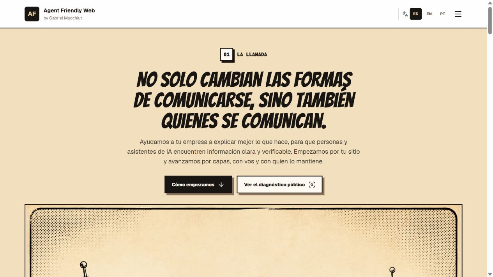
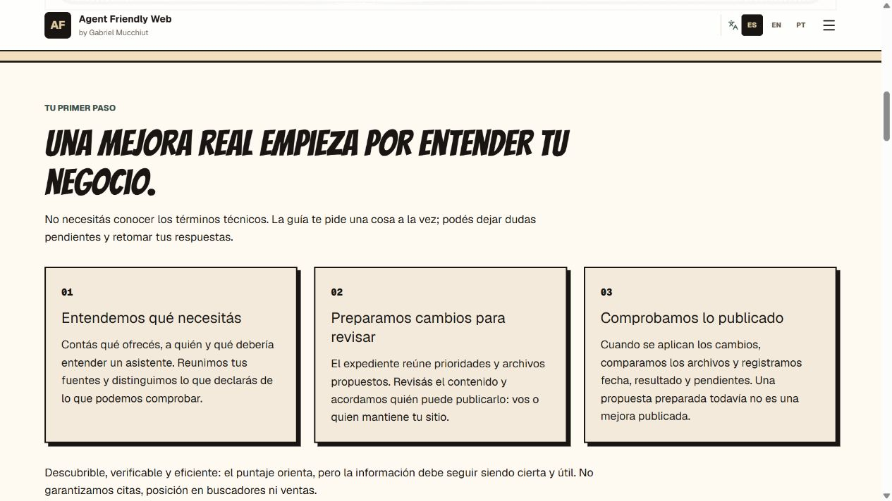
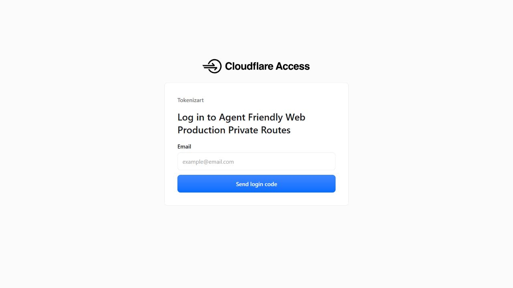
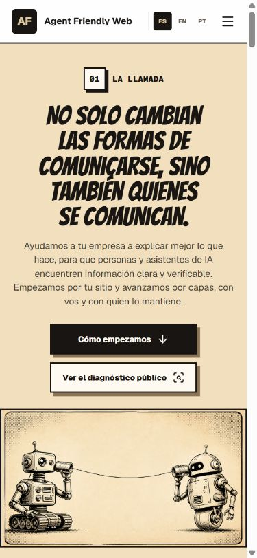
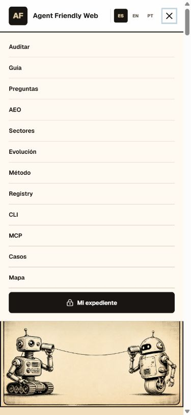
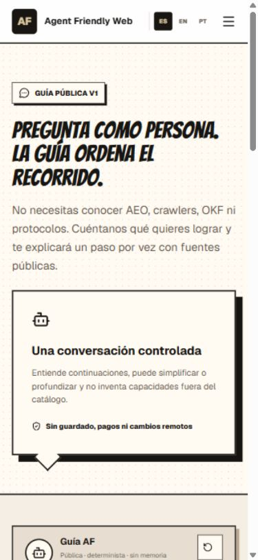
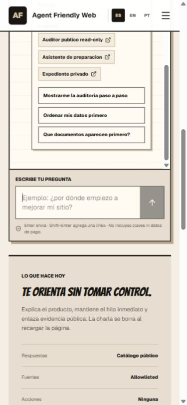
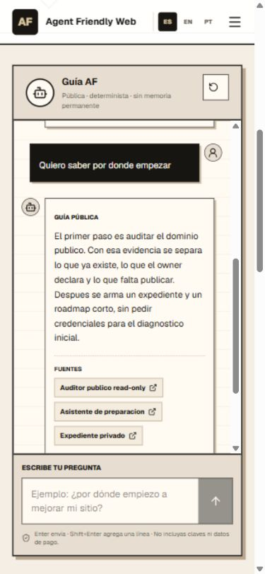

# AFW: revisión acotada de la entrada pública
20oct2026 · capturas nuevas16:53–17:04UTC · observación propia, no ensayo con clientes.

## Alcance y objetivo
Recorrer portada → explicación de inicio → acceso protegido; comprobar menú y guía pública en móvil. Navegador integrado IAB, viewport inicial1265×712 y override móvil390×844. No se introdujo identidad, OTP, credencial, dato de expediente o cliente; no se solicitó diagnóstico remoto, reconexión ni permiso. Un preset público propio de la guía fue la única consulta; no modifica el expediente. Tab creada para esta revisión cerrada y viewport restaurado.

La revisión termina en la pantalla de ingreso y en la guía pública. No certifica el recorrido privado después del login, envío de códigos, suscripción/revisión cloud/baja de avisos, Container, PC-off o Max. No repite G2 aceptado.

## Pasos y capturas inspeccionadas
### 1. Portada pública
Correcta en el alcance observado; identidad comic, dos caminos de entrada y contenido legible.

### 2. Cómo empezamos
Ancla llega a la explicación estable; distingue entender, preparar y comprobar.

### 3. Empezar mi expediente
Conduce a Cloudflare Access, como avisa la portada; nombre técnico y marca de realm son riesgo de claridad.

### 4. Portada móvil
Sin desborde horizontal observado; CTAs completos. Override390×844, contenido375px por scrollbar.

### 5. Menú móvil
Enter abre menú; expanded/foco visibles y enlace Guía accesible.

### 6. Entrada de guía
Contenido estable; conversación/compositor requieren bajar. Hay terminología técnica.

### 7. Compositor y límites
Campo etiquetado, envío vacío deshabilitado; Allowlisted es poco claro para esta audiencia.

### 8. Orientación propia de prueba
Preset devuelve orientación y fuentes; texto español sin tildes y con owner/roadmap.

## Hallazgos y cambio acotado
1. **Claridad de ingreso — pendiente de configuración separada.** El paso3 muestra «Tokenizart» y «Agent Friendly Web Production Private Routes». La protección es esperada; no es un fallo de autenticación. Puede desconcertar a quien llega desde AFW. Recomendar un nombre de aplicación AFW orientado a la persona y explicar el proveedor de acceso. No cambiar el realm compartido por AFW ni editar políticas por una cuestión visual. La API observada ofrece PUT de aplicación, no PATCH de solo nombre: antes de un cambio se requiere identificar la aplicación exacta, preservar configuración/políticas y reversión y comprobar el resultado. No se realizó esa mutación ni se promete una pantalla nueva.
2. **Palabras de implementación y lectura — corrección de fuente preparada.** Pasos6–8 exponen determinista/Allowlisted y respuestas españolas sin tildes, con owner/roadmap. Acotar la mejora a etiquetas simples ES/EN/PT e introducción/inicio en español, sin cambiar estados, enlaces, permisos, modelo, fuentes o comportamiento. La explicación técnica detallada permanece disponible donde aporta contexto. La publicación web y su comparación visual posterior son pasos separados: estas capturas son el ANTES, no evidencia de la candidata desplegada.
3. **Descubrimiento del compositor móvil — oportunidad diferida.** Paso6 deja la entrada debajo del primer viewport; pasos7–8 tienen desplazamiento de página y conversación. No se reprodujo un bloqueo ni pérdida de datos. Evaluar una entrada más directa o probar con usuarios antes de rediseñar la estructura; no introducir un cambio de layout desde esta observación única.

La distinción «menos clics humanos no implica menos valor de una web propia» ya quedó integrada en fuente por PR523, pero no aparece todavía en esta portada desplegada. Eso es publicación pendiente, no una medición de efecto o falla del texto nuevo.

## Accesibilidad: observaciones y límites
Encabezados/etiquetas y fuentes visibles; el menú respondió a Enter y expuso estado expanded/foco. EN midió28×28px; no se observó desborde horizontal de la portada móvil. Son comprobaciones puntuales, no una auditoría WCAG. No se verificó el recorrido completo de Tab, lector de pantalla, contraste medido, zoom200%, reducción de movimiento o formularios privados. La primera captura del desplazamiento todavía animado fue descartada; se conserva únicamente la captura estable del paso2 en este informe.

## Evidencia y conservación
Imágenes públicas exactas, sin barra de URL/queries de login, correo o datos privados. Capturadas e inspeccionadas desde el archivo guardado,440097bytes en total. El [manifiesto](evidence/2026-10-20-public-entry/captures.json) conserva fecha de guardado, tamaño y SHA256 por imagen; también se guardan en el mismo repositorio AFW. No son capturas históricas reusadas ni imágenes reconstruidas.

## Cierre
Entrada pública comprobada hasta su gate de login; guía y menú móvil observados. Corrección de microcopy se valida por los controles existentes de guía/i18n/contrato y build; no añadir pruebas que solo repitan palabras nuevas. Ninguna publicación o mejora de conversión se deduce de fuente/CI. Mantener el nombre de acceso y la oportunidad de compositor como pendientes explícitos. operationalReadiness=false.
