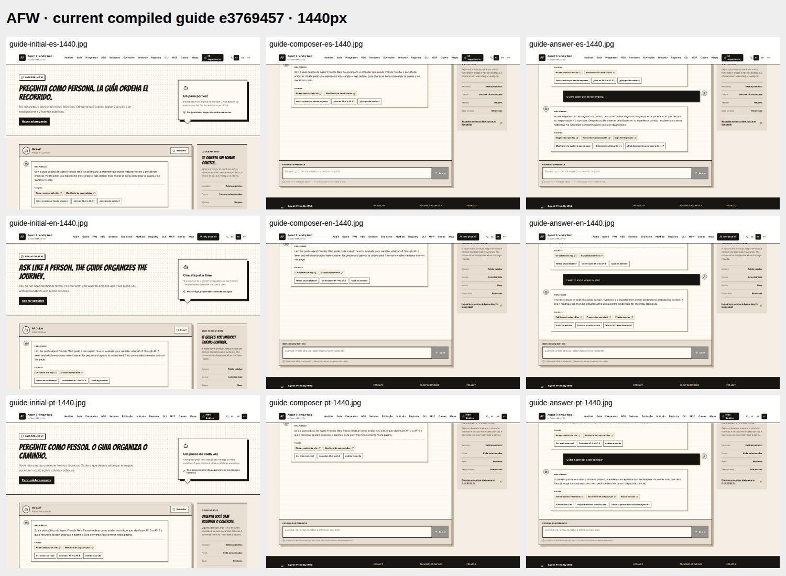
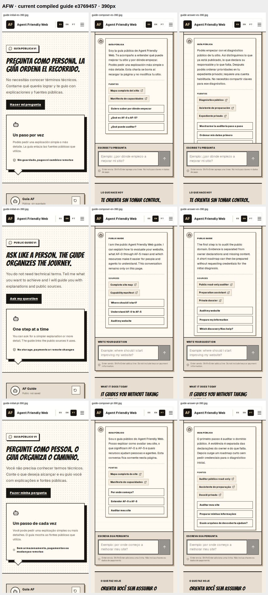

# Guía pública: acceso a la pregunta y respuesta legible

Capturas reales de la aplicación compilada en GitHub. **No son producción ni un mockup.** Producto e3769457; [native39487383811](https://github.com/tokenizartinfo-ops/agent-friendly-web/actions/runs/39487383811), seis casos ES/EN/PT desktop1440x900 y móvil390x844,18estados. Artefacto12294331600; hashes y procedencia de7JPEGs en captures.json. Las dos hojas preservan los18estados, además de tres imágenesES390 a tamaño original.

El campo tiene foco real y queda libre de la cabecera sticky; el párrafo nuevo se lee dentro del panel. El panel conserva su desplazamiento para ver fuentes y opciones restantes. No se afirma que toda la conversación ni todas las opciones entren simultáneamente.
[EntradaES390](guide-initial-es-390.jpg) · [CampoES390](guide-composer-es-390.jpg) · [RespuestaES390](guide-answer-es-390.jpg).

## Evidencia negativa preservada
Antes: e4bd18f3, artefacto12294580141. La comprobación inicial de geometría había pasado, pero la inspección visual mostró campo cubierto por navegación y respuesta fuera de vista. **No es UX aceptada.**
[Antes: campo](before-composer-es-390.jpg) · [Antes: respuesta](before-answer-es-390.jpg).
El RED de visibilidad posteriorcc99cf2e/39487075046 midió ambas faltas antes de corregir producto.

## Alcance
Esto prueba únicamente el recorrido público sintético y teclado/viewport Chromium. No prueba configuración Cloudflare, identidad privada, accesibilidad completa, hardware/teclado virtual real, modelos, eventos/Containers, guardia permanente, PC-off o Max. operationalReadiness=false.
Las imágenes conservadas proceden dee376; no atribuirlas a un arnés/revisión posteriores aunque el código de producto sea idéntico.
