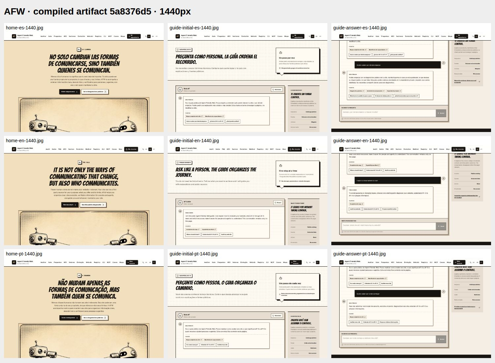
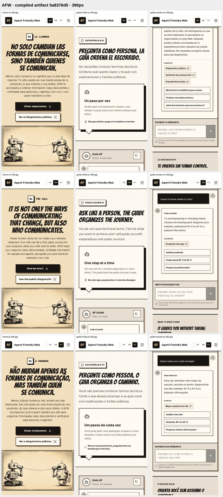

# Capturas: candidata pública compilada de AFW
Producto5a8376d5d70dbb007190cd2eae23b10651a70f49; arnésb987d8769aa676225226854e2c4521b90c1375ea. Ejecución39481514563/job118830993367,20oct2026,19:13UTC. [Manifiesto](captures.json) fija huellas/tamaños/Gitblobs y los seis casos.18capturas de páginas reales y2contactos de esas mismas imágenes. No imágenes generadas, prototipo de layout ni edición del sitio: Chromium abrió el paquete compilado original en workerd efímero GitHub.

## Inspección
Se inspeccionaron los dos contactos (18estados), y a tamaño original la portadaES390, guía inicialES1440 y respuestaES390. La portada mantiene su tipografía/robots/colores y explica la fuente propia sin prometer selección por una LLM. La llamada a la explicación permanece en la primera pantalla en seis casos; idioma, un h1, rutas, teclado y ausencia de overflow horizontal comprobados. La guíaES aclara límites/sin guardado y muestra orientación con fuentes públicas. Las capturas de respuesta son vistas desplazadas; no certifican que toda la respuesta quepa en una pantalla.

El ensayo recorrió portada→ancla de inicio, inspección de enlace privado SIN abrirlo, guía→mensaje propio sintético→respuesta. Capturas de portada, guía inicial y respuesta para ES/EN/PT,1440×900 y390×844. Movimiento reducido activado. La comprobación automática de respuesta demuestra consistencia con el módulo actual; NO calidad lingüística ni equivalencia semántica: ES eligió getting_started y EN/PT clarification para frases equivalentes. Este comportamiento existente queda como seguimiento de orientación multilingüe, además del ajuste editorial opcional de PR526; no se oculta como éxito semántico.

En móvil, introducción y nota desplazan el compositor hacia abajo; se conserva la oportunidad de simplificación observada en la revisión pública anterior. No se cambió el layout ni se declara solucionada esa oportunidad. Sin nuevo contraste/lector de pantalla/WCAG, datos privados, login, modelo, diagnóstico remoto, servicio Cloudflare/callback real, Containers o PC-off acreditados.

## Contactos

## Capturas individuales
- [guide-answer-en-1440.jpg](guide-answer-en-1440.jpg)
- [guide-answer-en-390.jpg](guide-answer-en-390.jpg)
- [guide-answer-es-1440.jpg](guide-answer-es-1440.jpg)
- [guide-answer-es-390.jpg](guide-answer-es-390.jpg)
- [guide-answer-pt-1440.jpg](guide-answer-pt-1440.jpg)
- [guide-answer-pt-390.jpg](guide-answer-pt-390.jpg)
- [guide-initial-en-1440.jpg](guide-initial-en-1440.jpg)
- [guide-initial-en-390.jpg](guide-initial-en-390.jpg)
- [guide-initial-es-1440.jpg](guide-initial-es-1440.jpg)
- [guide-initial-es-390.jpg](guide-initial-es-390.jpg)
- [guide-initial-pt-1440.jpg](guide-initial-pt-1440.jpg)
- [guide-initial-pt-390.jpg](guide-initial-pt-390.jpg)
- [home-en-1440.jpg](home-en-1440.jpg)
- [home-en-390.jpg](home-en-390.jpg)
- [home-es-1440.jpg](home-es-1440.jpg)
- [home-es-390.jpg](home-es-390.jpg)
- [home-pt-1440.jpg](home-pt-1440.jpg)
- [home-pt-390.jpg](home-pt-390.jpg)

## Integridad y conservación
Descarga autenticada con GitHubCLI del artefacto12291299713 en un directorio propio de evidencia local; unos2MB comprimidos, sin browser/build/deps locales. SHA256 y GitSHA1 de cada JPEG se calcularon con lectura pequeña y se comprobaron contra los blobs al guardarlos en ESTE repositorio. No se copian URLs de archivo firmadas, configuraciones ni credenciales. Se conservan imágenes únicas; los contactos son derivados explícitos de las capturas.

Estas imágenes preceden al refuerzo de cleanup del arnés: el producto/ZIP no cambia, pero no se atribuyen a una revisión posterior. El artefacto cloud vence27oct19:13:52UTC; estas copias versionadas conservan evidencia después de ese plazo. El arnés final requiere su propio GREEN/cleanup y revisión registrados en la PR. operationalReadiness=false.
